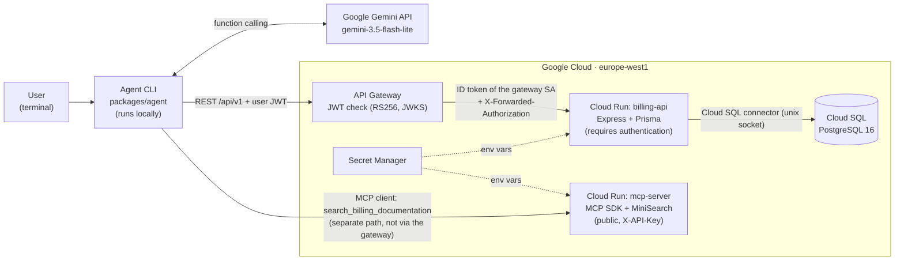
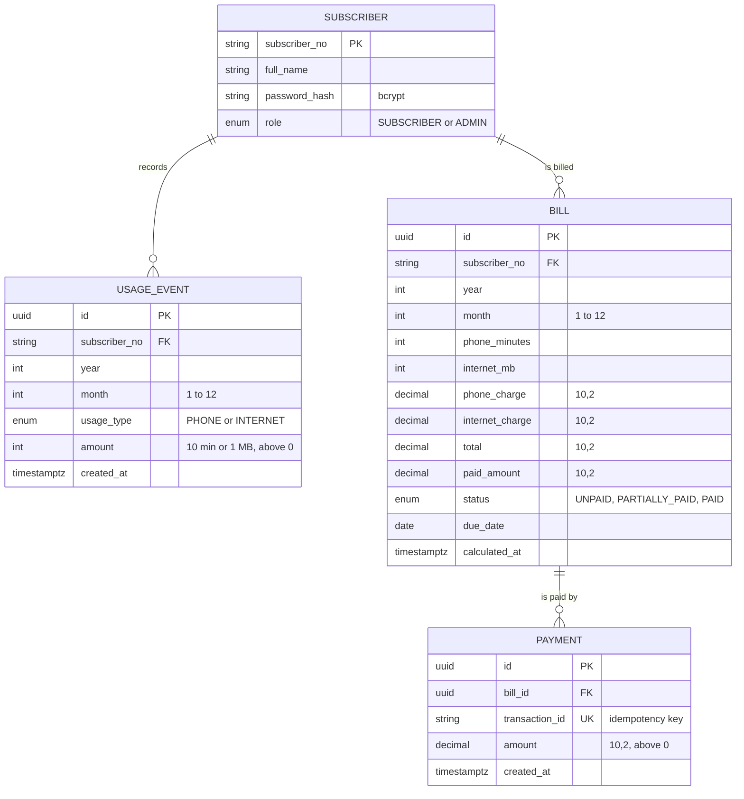

# billwise-agent

A conversational billing-support agent for a mobile carrier. A user chats in a terminal. An LLM (Google
Gemini, with real function calling) decides which tool to use. The agent runs it: an **MCP server**
searches the indexed billing policy guide, and the **Billing REST API** (always reached through **GCP API
Gateway**) reads usage and bills and takes payments. Answers come from tool results and cite guide sections
("according to Section 3.2"). Payments need an explicit `EVET`/`YES`, and that rule is enforced in code, not in
the prompt. Everything runs on Google Cloud: Cloud Run, Cloud SQL for PostgreSQL and API Gateway.

_Originally built as the Midterm project for SE 4458 at Yaşar University._

## Live links

| What                                                                  | URL                                                                                                                |
| --------------------------------------------------------------------- | ------------------------------------------------------------------------------------------------------------------ |
| API Gateway (all REST traffic)                                        | `https://billwise-gw-28mjkppx.ew.gateway.dev`                                                                      |
| Swagger UI (through the gateway)                                      | <https://billwise-gw-28mjkppx.ew.gateway.dev/api/v1/docs>                                                          |
| OpenAPI 3 document                                                    | <https://billwise-gw-28mjkppx.ew.gateway.dev/api/v1/openapi.json> · source: [docs/openapi.yaml](docs/openapi.yaml) |
| JWKS (public keys)                                                    | <https://billwise-gw-28mjkppx.ew.gateway.dev/.well-known/jwks.json>                                                |
| MCP server (Streamable HTTP, `X-API-Key`; **not** behind the gateway) | `https://mcp-server-rswe5l4uia-ew.a.run.app/mcp`                                                                   |
| Demo video                                                            | <https://www.youtube.com/watch?v=VdGLZU7kEhI>                                                                      |
| Evidence (logs, traces, test output)                                  | [docs/evidence/](docs/evidence/README.md)                                                                          |

The services scale to zero when idle. The **first request after a pause takes about 8 s** (a cold start), and after that about 0.4 s.

## Architecture



- **All REST calls go through the gateway.** The billing-api Cloud Run service only accepts calls from the gateway's service account, so calling its URL directly returns **403**.
- **The MCP path is separate**, as the course requires: the agent talks to the MCP server directly, with an API key.
- **The agent never takes a subscriber number from the LLM or the user.** It always uses the `sub` claim of the logged-in user's JWT.

## Requirements traceability

Every item from the course checklist, with where it is implemented and where the evidence is.

| Requirement                                                                                                                 | Implemented in                                                                                                                                            | Evidence                                                                                                                                                                      |
| --------------------------------------------------------------------------------------------------------------------------- | --------------------------------------------------------------------------------------------------------------------------------------------------------- | ----------------------------------------------------------------------------------------------------------------------------------------------------------------------------- |
| **Core components**                                                                                                         |                                                                                                                                                           |                                                                                                                                                                               |
| LLM agent with **real tool/function calling** (no keyword routing)                                                          | [agent.ts](packages/agent/src/agent.ts) (loop), [llm/gemini.ts](packages/agent/src/llm/gemini.ts) (function declarations)                                 | [01](docs/evidence/01-agent-mcp-only.md), [02](docs/evidence/02-agent-api-only.md), [03](docs/evidence/03-agent-combined.md) · [AI agent](#ai-agent)                          |
| MCP server with the real MCP SDK, `search_billing_documentation(query)` returning section ID, heading, document ID and text | [mcp-server/src/server.ts](packages/mcp-server/src/server.ts), [search.ts](packages/mcp-server/src/search.ts)                                             | [04-mcp-retrieval.md](docs/evidence/04-mcp-retrieval.md) (tool schema from `listTools`)                                                                                       |
| Document **indexed once, before queries**                                                                                   | [scripts/build-index.ts](packages/mcp-server/src/scripts/build-index.ts), [index-file.ts](packages/mcp-server/src/index-file.ts) (loaded once at startup) | [MCP server](#mcp-server), [index-file.test.ts](packages/mcp-server/src/index-file.test.ts)                                                                                   |
| Transactional REST API on a **server database** (PostgreSQL)                                                                | [billing-api](packages/billing-api/src), [repositories/prisma.ts](packages/billing-api/src/repositories/prisma.ts) (transactions, `SELECT … FOR UPDATE`)  | [08-integration-tests.txt](docs/evidence/08-integration-tests.txt)                                                                                                            |
| API Gateway: **all** REST calls (agent included) go through it; MCP path separate                                           | [infra/gateway/openapi-gateway.tmpl.yaml](infra/gateway/openapi-gateway.tmpl.yaml), agent `BILLING_API_URL` = gateway                                     | [05-gateway-protected-route.md](docs/evidence/05-gateway-protected-route.md)                                                                                                  |
| **APIs**                                                                                                                    |                                                                                                                                                           |                                                                                                                                                                               |
| Add Usage (auth; +10 min phone / +1 MB internet)                                                                            | [usage.routes.ts](packages/billing-api/src/routes/usage.routes.ts), [usage.service.ts](packages/billing-api/src/services/usage.service.ts)                | [usage.routes.test.ts](packages/billing-api/src/routes/usage.routes.test.ts), Swagger                                                                                         |
| Calculate Bill (auth)                                                                                                       | [bills.routes.ts](packages/billing-api/src/routes/bills.routes.ts), [domain/billing.ts](packages/billing-api/src/domain/billing.ts)                       | [calculate.routes.test.ts](packages/billing-api/src/routes/calculate.routes.test.ts), [billing.test.ts](packages/billing-api/src/domain/billing.test.ts)                      |
| Query Bill (no auth)                                                                                                        | [bills.routes.ts](packages/billing-api/src/routes/bills.routes.ts)                                                                                        | [query.routes.test.ts](packages/billing-api/src/routes/query.routes.test.ts), [02](docs/evidence/02-agent-api-only.md)                                                        |
| Query Bill Detailed (auth, **paging**)                                                                                      | [bills.routes.ts](packages/billing-api/src/routes/bills.routes.ts)                                                                                        | [query.routes.test.ts](packages/billing-api/src/routes/query.routes.test.ts), [05](docs/evidence/05-gateway-protected-route.md)                                               |
| Pay Bill (auth; partial/full; duplicate transaction ID rejected)                                                            | [payments.routes.ts](packages/billing-api/src/routes/payments.routes.ts), [payment.service.ts](packages/billing-api/src/services/payment.service.ts)      | [payments.routes.test.ts](packages/billing-api/src/routes/payments.routes.test.ts), [08](docs/evidence/08-integration-tests.txt), [06](docs/evidence/06-confirmed-payment.md) |
| **Common rules**                                                                                                            |                                                                                                                                                           |                                                                                                                                                                               |
| Versioned APIs (`/api/v1/...`)                                                                                              | all routes                                                                                                                                                | [REST API](#rest-api)                                                                                                                                                         |
| Swagger UI / OpenAPI                                                                                                        | [docs/openapi.yaml](docs/openapi.yaml), [docs.routes.ts](packages/billing-api/src/routes/docs.routes.ts)                                                  | live Swagger link above; [docs.routes.test.ts](packages/billing-api/src/routes/docs.routes.test.ts) (spec ↔ routes)                                                           |
| JWT for payments, account details and admin operations                                                                      | [auth/](packages/billing-api/src/auth) (RS256 + JWKS) + gateway JWT check                                                                                 | [Authentication](#authentication-and-authorization), [05](docs/evidence/05-gateway-protected-route.md)                                                                        |
| A subscriber number in the prompt **cannot** reach someone else's data                                                      | REST tools have no `subscriberNo` ([rest-tools.ts](packages/agent/src/tools/rest-tools.ts)); API check `sub == subscriberNo`                              | [agent.test.ts](packages/agent/src/agent.test.ts), [05](docs/evidence/05-gateway-protected-route.md) (403)                                                                    |
| **Explicit confirmation** before writes/payments                                                                            | [payment-gate.ts](packages/agent/src/tools/payment-gate.ts)                                                                                               | [06-confirmed-payment.md](docs/evidence/06-confirmed-payment.md), [payment-gate.test.ts](packages/agent/src/tools/payment-gate.test.ts)                                       |
| Gateway: ≥ 2 routes, one protected; a versioned public route; gateway URL; route mapping; an error example                  | [gateway config](infra/gateway/openapi-gateway.tmpl.yaml)                                                                                                 | [API Gateway](#api-gateway), [gateway-401-example.json](infra/gateway-401-example.json)                                                                                       |
| Service-oriented development                                                                                                | 3 services (agent, billing-api, mcp-server); billing-api layered routes → services → repositories                                                         | [Architecture](#architecture)                                                                                                                                                 |
| ER / data model                                                                                                             | [schema.prisma](packages/billing-api/prisma/schema.prisma) + migrations                                                                                   | [Data model](#data-model)                                                                                                                                                     |
| Cloud deploy (API, MCP, gateway, DB)                                                                                        | [infra/deploy.sh](infra/deploy.sh), Dockerfiles                                                                                                           | [Deployment](#deployment-google-cloud), [infra/README.md](infra/README.md)                                                                                                    |
| LLM cost documented + low-cost, testable approach                                                                           | Flash-Lite free tier, mock provider ([llm/mock.ts](packages/agent/src/llm/mock.ts))                                                                       | [Costs](#costs)                                                                                                                                                               |
| Simple CLI or web chat                                                                                                      | [cli.ts](packages/agent/src/cli.ts) (`npm run chat`)                                                                                                      | [01](docs/evidence/01-agent-mcp-only.md)–[03](docs/evidence/03-agent-combined.md)                                                                                             |
| **Unit tests**                                                                                                              |                                                                                                                                                           |                                                                                                                                                                               |
| ≥ 1 success + ≥ 1 failure/edge case per REST operation                                                                      | `packages/billing-api/src/routes/*.test.ts`                                                                                                               | [Testing](#testing), [07-unit-tests.txt](docs/evidence/07-unit-tests.txt)                                                                                                     |
| Business logic, input validation, expected responses                                                                        | [billing.test.ts](packages/billing-api/src/domain/billing.test.ts), [money.test.ts](packages/billing-api/src/domain/money.test.ts), route tests           | [07-unit-tests.txt](docs/evidence/07-unit-tests.txt)                                                                                                                          |
| Run without cloud and without a live LLM                                                                                    | in-memory repository fakes, mock LLM, fake MCP client                                                                                                     | [07-unit-tests.txt](docs/evidence/07-unit-tests.txt)                                                                                                                          |
| Test code, how to run them, proof of a successful run                                                                       | this README                                                                                                                                               | [Testing](#testing), [07](docs/evidence/07-unit-tests.txt), [08](docs/evidence/08-integration-tests.txt)                                                                      |
| **Deliverables**                                                                                                            |                                                                                                                                                           |                                                                                                                                                                               |
| Source code, README, Swagger/OpenAPI, ER diagram                                                                            | this repository                                                                                                                                           | [docs/openapi.yaml](docs/openapi.yaml), [Data model](#data-model)                                                                                                             |
| Gateway URL + routes; MCP tool schema + indexing approach                                                                   |                                                                                                                                                           | [Live links](#live-links), [API Gateway](#api-gateway), [MCP server](#mcp-server)                                                                                             |
| Deployment instructions / URLs                                                                                              | [infra/README.md](infra/README.md)                                                                                                                        | [Deployment](#deployment-google-cloud)                                                                                                                                        |
| Short demo video                                                                                                            |                                                                                                                                                           | [youtube.com/watch?v=VdGLZU7kEhI](https://www.youtube.com/watch?v=VdGLZU7kEhI)                                                                                                | [Live links](#live-links) |
| Screenshots/logs: 3 agent scenarios (MCP-only, API-only, combined) + tool trace                                             |                                                                                                                                                           | [01](docs/evidence/01-agent-mcp-only.md), [02](docs/evidence/02-agent-api-only.md), [03](docs/evidence/03-agent-combined.md)                                                  |
| 3 different MCP retrieval tests                                                                                             |                                                                                                                                                           | [04-mcp-retrieval.md](docs/evidence/04-mcp-retrieval.md)                                                                                                                      |
| Protected gateway route                                                                                                     |                                                                                                                                                           | [05-gateway-protected-route.md](docs/evidence/05-gateway-protected-route.md)                                                                                                  |
| Confirmed simulated payment                                                                                                 |                                                                                                                                                           | [06-confirmed-payment.md](docs/evidence/06-confirmed-payment.md)                                                                                                              |
| How the unit tests are run                                                                                                  |                                                                                                                                                           | [Testing](#testing)                                                                                                                                                           |
| Test data + steps the instructor can reproduce                                                                              | [seed](packages/billing-api/src/db/seed-data.ts)                                                                                                          | [For the instructor](#for-the-instructor-reproduce-it)                                                                                                                        |
| Assumptions (rounding, policy reading, errors, identity, deployment)                                                        |                                                                                                                                                           | [Assumptions](#assumptions)                                                                                                                                                   |
| **Rules from the billing guide (MOB-BILLING-2026-01)**                                                                      |                                                                                                                                                           |                                                                                                                                                                               |
| 4.4: a computed estimate is never presented as the stored bill                                                              | prompt rule 4; bills only come from the API                                                                                                               | [03](docs/evidence/03-agent-combined.md)                                                                                                                                      |
| 5.2: subscriber, period and amount shown, explicit confirmation                                                             | [payment-gate.ts](packages/agent/src/tools/payment-gate.ts)                                                                                               | [06](docs/evidence/06-confirmed-payment.md)                                                                                                                                   |
| 5.3: success only after the API confirms; idempotent retries                                                                | one UUID per payment, 409 + `existingPayment`                                                                                                             | [06](docs/evidence/06-confirmed-payment.md), [08](docs/evidence/08-integration-tests.txt)                                                                                     |
| 6.1: due date 15 days after the end of the billing month                                                                    | [domain/billing.ts](packages/billing-api/src/domain/billing.ts)                                                                                           | [billing.test.ts](packages/billing-api/src/domain/billing.test.ts)                                                                                                            |
| 7.2 / 7.3: no dispute API, only the process; no refund promises                                                             | prompt rules 5; MCP sections 7.x                                                                                                                          | [04](docs/evidence/04-mcp-retrieval.md) (5b table), [cloud trace](docs/evidence/traces/2026-11-18-cloud-demo.json) (f, g)                                                     |
| 8.2: "why is my bill higher?" → Query Bill Detailed + sections 2–4, no invented usage                                       | prompt "tools" rule                                                                                                                                       | [03-agent-combined.md](docs/evidence/03-agent-combined.md)                                                                                                                    |

## For the instructor: reproduce it

**A. Against the deployed cloud (no setup).** The cloud database holds the documented seed state (see [Seed data](#seed-data)).

```bash
GW=https://billwise-gw-28mjkppx.ew.gateway.dev
curl -s $GW/api/v1/health/ready; echo                 # first call may take ~8 s (cold start)

# Protected route without a token → 401 from the gateway
curl -s -i -X POST -H 'content-type: application/json' -d '{}' $GW/api/v1/payments; echo

# Public, versioned route
curl -s "$GW/api/v1/bills/5551000002?month=10&year=2026"; echo

# Log in (demo account), then call a JWT route → 200
TOKEN=$(curl -s -X POST -H 'content-type: application/json' \
  -d '{"subscriberNo":"5551000002","password":"user-demo-pass"}' $GW/api/v1/auth/login \
  | node -p "JSON.parse(require('fs').readFileSync(0)).accessToken")
curl -s -H "Authorization: Bearer $TOKEN" "$GW/api/v1/bills/5551000002/detailed?month=10&year=2026&pageSize=5"; echo

# Someone else's account → 403 (API rule, checked after the gateway's JWT check)
curl -s -H "Authorization: Bearer $TOKEN" "$GW/api/v1/bills/5551000001/detailed?month=10&year=2026"; echo
```

Swagger UI: <https://billwise-gw-28mjkppx.ew.gateway.dev/api/v1/docs>. "Authorize" takes the `accessToken` from the login response.

**B. The agent against the cloud API.**

```bash
npm ci
cp .env.example .env            # set GEMINI_API_KEY (Google AI Studio) or LLM_PROVIDER=mock
echo "BILLING_API_URL=https://billwise-gw-28mjkppx.ew.gateway.dev" > .env.cloud
npm run chat:cloud              # log in as 5551000002 / user-demo-pass
```

- **Where the MCP search runs:** without `MCP_API_KEY`, the agent starts the MCP server **locally over stdio**, which is the same code and index. The cloud MCP endpoint needs the key; I can share it on request.
- **What to ask:**
  - "Ek internet ne kadar?" (MCP only)
  - "Ekim faturam ne kadar?" (API only)
  - "Ekim faturam neden yüksek?" (both)
  - "Ekim faturamın 30 dolarını öde", then `EVET` (payment)
- **A payment changes the cloud data.** I re-seed after demos.

**C. Fully local (Docker).** See [Quick start (local)](#quick-start-local). The scripted demo, `npm run demo`, runs all 8 scenarios and resets its own local database.

## Contents

[Quick start](#quick-start-local) · [Seed data](#seed-data) · [REST API](#rest-api) · [API Gateway](#api-gateway) · [Authentication](#authentication-and-authorization) · [MCP server](#mcp-server) · [AI agent](#ai-agent) · [Data model](#data-model) · [Testing](#testing) · [Deployment](#deployment-google-cloud) · [Costs](#costs) · [Security notes](#security-notes) · [Assumptions](#assumptions) · [Project layout and commands](#project-layout-and-commands) · [License](#license)

## Quick start (local)

**Prerequisites:** Node.js ≥ 22, Docker. For the live LLM you also need a Gemini API key from Google AI Studio (free tier). `LLM_PROVIDER=mock` works without one.

```bash
npm ci                                            # installs all workspaces, generates the Prisma client
cp .env.example .env                              # then fill in the values below
npm run keys:generate -w @billwise/billing-api    # writes a new RS256 JWT_PRIVATE_KEY into .env
#   MCP_API_KEY: node -e "console.log(require('crypto').randomBytes(24).toString('base64url'))"
#   GEMINI_API_KEY: from Google AI Studio (or LLM_PROVIDER=mock)
npm run db:up                                     # PostgreSQL 16 in Docker (localhost:5432)
npm run db:deploy -w @billwise/billing-api        # apply the migrations
npm run db:seed -w @billwise/billing-api          # demo data (wipes and re-seeds)
npm run build

npm start -w @billwise/billing-api                # http://localhost:3000, Swagger at /api/v1/docs
npm start -w @billwise/mcp-server                 # http://localhost:3001/mcp (second terminal)
npm run chat                                      # third terminal: log in, then chat
```

`npm run demo` (or `npm run demo -- --only a,d`) needs no extra terminals:

- It starts the services from `dist/` if they're down and re-seeds the local DB.
- It runs the 8 scripted scenarios **a–h** and prints a summary table.
- It writes a JSON trace to `packages/agent/traces/`.
- It costs about 16 Gemini requests.

## Seed data

All data is fictitious. The seed wipes the tables and inserts them again, so it can be re-run any time.

| Login        | Role       | Password (demo)   | Data                                                                                                                                |
| ------------ | ---------- | ----------------- | ----------------------------------------------------------------------------------------------------------------------------------- |
| `admin`      | ADMIN      | `admin-demo-pass` | can add usage and calculate bills for anyone; has no bills itself                                                                   |
| `5551000001` | SUBSCRIBER | `user-demo-pass`  | Sep 2026 **$50 PAID** (payment `seed-5551000001-2026-09-1`); Oct 2026 **$50 UNPAID**                                                |
| `5551000002` | SUBSCRIBER | `user-demo-pass`  | Oct 2026: 1,350 min + 35 GB = **$80 UNPAID** (due 2026-11-15); Nov 2026 has usage but **no calculated bill** (404 → Calculate demo) |
| `5551000003` | SUBSCRIBER | `user-demo-pass`  | Oct 2026: 1,800 min + 22.5 GB = $70, $30 paid → **PARTIALLY_PAID**, $40 remaining                                                   |

There are 73,910 usage events in total.

- **Passwords:** the demo values are set in `.env` (`SEED_ADMIN_PASSWORD`, `SEED_USER_PASSWORD`).
- **Cloud and local:** the cloud database uses the same seed.
- **Production guard:** the seed refuses `NODE_ENV=production` unless you pass `--force`.

## REST API

The billing-api package is Express 5, zod and Prisma 7 on PostgreSQL 16, layered as **routes** (HTTP + zod) → **services** (business rules, integer cents) → **repositories** (Prisma behind an interface, with in-memory fakes for the unit tests). Billing math is a pure function in [domain/billing.ts](packages/billing-api/src/domain/billing.ts).

| Method | Path                                                             | Auth (API)                    | Paging                                         | Purpose                                                                            |
| ------ | ---------------------------------------------------------------- | ----------------------------- | ---------------------------------------------- | ---------------------------------------------------------------------------------- |
| POST   | `/api/v1/auth/login`                                             | –                             | –                                              | `{subscriberNo, password}` → `{accessToken, tokenType, expiresIn: 3600}`           |
| POST   | `/api/v1/usage`                                                  | JWT, **ADMIN**                | –                                              | Add Usage: one event, `PHONE` = +10 min, `INTERNET` = +1 MB (no amount parameter)  |
| POST   | `/api/v1/bills/calculate`                                        | JWT, **ADMIN**                | –                                              | Calculate Bill for `{subscriberNo, year, month}`; recalculation keeps `paidAmount` |
| GET    | `/api/v1/bills/{subscriberNo}?month&year`                        | – (public by spec)            | –                                              | Query Bill: total, paid amount, remaining balance, status, due date                |
| GET    | `/api/v1/bills/{subscriberNo}/detailed?month&year&page&pageSize` | JWT, **own account or ADMIN** | ✓ `page` from 1, `pageSize` 1–100 (default 20) | Query Bill Detailed: usage + charge breakdown + paged usage events                 |
| POST   | `/api/v1/payments`                                               | JWT, **own account or ADMIN** | –                                              | Pay Bill `{subscriberNo, year, month, amount, transactionId}`: full or partial     |
| GET    | `/api/v1/health`, `/api/v1/health/ready`                         | –                             | –                                              | liveness; readiness (DB `SELECT 1`, 503 when down)                                 |
| GET    | `/.well-known/jwks.json`                                         | –                             | –                                              | public signing key (JWKS)                                                          |
| GET    | `/api/v1/docs`, `/api/v1/openapi.json`                           | –                             | –                                              | Swagger UI (redirects to `/api/v1/docs/index.html`), OpenAPI 3 document            |

- **Versioning:** every public route is under `/api/v1`. A `v2` can be added next to it (new paths in the same gateway config) without breaking v1 clients.
- **Swagger:** [docs/openapi.yaml](docs/openapi.yaml) (OpenAPI 3) is served as Swagger UI. A unit test fails if the spec and the implemented routes differ.
- **Money:**
  - Requests and responses use dollars as JSON numbers (`30.5`).
  - Internally every amount is an **integer number of cents**, and the DB stores `decimal(10,2)`. So there's no float rounding anywhere.
  - Amounts with more than 2 decimals are rejected with 400, never rounded.
- **Pricing (guide 2–4):**
  - Phone: 1,000 minutes included, then $10 per started 1,000-minute block.
  - Internet: $50 for up to 20 GB, then $10 per started 10 GB block (1 GB = 1,000 MB).
  - No taxes or fees.
  - Due date: 15 days after the end of the billing month.

<details><summary><b>Error format and codes</b></summary>

One shape everywhere: `{ "error": { "code", "message", "traceId" } }`. The `traceId` is also in the `X-Trace-Id` response header and in the Cloud Logging entry.

| HTTP | Code                                           | When                                                                                                                                |
| ---- | ---------------------------------------------- | ----------------------------------------------------------------------------------------------------------------------------------- |
| 400  | `VALIDATION_ERROR`                             | invalid body or query (zod; names the first bad field), malformed JSON, `pageSize` > 100, more than 2 decimals                      |
| 401  | `UNAUTHORIZED`                                 | missing, invalid or expired token; wrong login (same message for an unknown user)                                                   |
| 403  | `FORBIDDEN`                                    | not ADMIN for usage/calculate; another subscriber's account (checked before any lookup, so it doesn't reveal whether a bill exists) |
| 404  | `BILL_NOT_FOUND`                               | bill not calculated yet (Query, Detailed, Pay)                                                                                      |
| 404  | `SUBSCRIBER_NOT_FOUND`                         | unknown or non-billable subscriber (for example `admin`) in usage/calculate                                                         |
| 404  | `NOT_FOUND`                                    | unknown route                                                                                                                       |
| 409  | `DUPLICATE_TRANSACTION`                        | `transactionId` already used; includes `existingPayment` when it was the same subscriber's own earlier payment                      |
| 422  | `BILL_ALREADY_PAID` / `AMOUNT_EXCEEDS_BALANCE` | nothing left to pay / amount above the remaining balance                                                                            |
| 500  | `INTERNAL_ERROR`                               | unexpected (no internals leak)                                                                                                      |
| 503  | `SERVICE_UNAVAILABLE`                          | `/health/ready` when the DB is down                                                                                                 |

Pay Bill checks in this order: 400 → 401/403 → 404 → 409 → 422. The 409 comes before the 422, so a retry of a payment that already closed the bill gets the duplicate answer, which carries the earlier result, instead of "already paid". At the gateway, missing or invalid JWTs are rejected earlier with the gateway's own format: `{"code":401,"message":"Jwt is missing"}`.

</details>

<details><summary><b>Example: Pay Bill request and response</b></summary>

```http
POST /api/v1/payments
Authorization: Bearer <token>
Content-Type: application/json

{ "subscriberNo": "5551000002", "year": 2026, "month": 10, "amount": 30, "transactionId": "42b93959-acc3-4e8d-b15f-9025331c9833" }
```

```json
{
  "paymentStatus": "SUCCESS",
  "transactionId": "42b93959-acc3-4e8d-b15f-9025331c9833",
  "amount": 30,
  "paidAmount": 30,
  "remainingBalance": 50,
  "billStatus": "PARTIALLY_PAID"
}
```

Retrying the same `transactionId` returns `409 DUPLICATE_TRANSACTION` with `existingPayment: { amount, paidAmount, remainingBalance, billStatus }`. Nothing is written twice.

</details>

## API Gateway

GCP API Gateway with an OpenAPI 2.0 config: [infra/gateway/openapi-gateway.tmpl.yaml](infra/gateway/openapi-gateway.tmpl.yaml). This is separate from the OpenAPI 3 documentation.

| Public route (gateway)                                             | Backend (Cloud Run billing-api) | Gateway security                |
| ------------------------------------------------------------------ | ------------------------------- | ------------------------------- |
| `POST /api/v1/auth/login`                                          | same path                       | public                          |
| `GET /api/v1/bills/{subscriberNo}`                                 | same path                       | public (versioned public route) |
| `GET /api/v1/health`, `/api/v1/health/ready`                       | same path                       | public                          |
| `GET /.well-known/jwks.json`                                       | same path                       | public                          |
| `GET /api/v1/docs`, `/api/v1/docs/{asset}`, `/api/v1/openapi.json` | same path                       | public (Swagger UI)             |
| `GET /api/v1/bills/{subscriberNo}/detailed`                        | same path                       | **JWT**                         |
| `POST /api/v1/payments`                                            | same path                       | **JWT**                         |
| `POST /api/v1/usage`                                               | same path                       | **JWT** (+ ADMIN in the API)    |
| `POST /api/v1/bills/calculate`                                     | same path                       | **JWT** (+ ADMIN in the API)    |

- **Route mapping:**
  - `x-google-backend` points at the Cloud Run URL with `path_translation: APPEND_PATH_TO_ADDRESS`, so `/api/v1/...` maps 1:1.
  - `jwt_audience` is the Cloud Run URL, and the backend deadline is 30 s (cold start measured at about 8 s).
  - Unknown paths get a 404 from the gateway itself.
- **JWT check at the gateway:**
  - The security definition uses issuer `billwise-billing-api`, audience `billwise-api`, and `x-google-jwks_uri = https://<gateway>/.well-known/jwks.json`, so the public key is fetched **through the gateway**.
  - Missing or invalid tokens never reach Cloud Run.
  - Role rules (ADMIN, own account) are enforced in the API, because the gateway can't check roles.
- **The gateway can't be bypassed:**
  - billing-api runs with `--no-allow-unauthenticated`. Only the `api-gateway` service account has `roles/run.invoker`.
  - The gateway calls Cloud Run with its **own** Google ID token. It forwards the user's token as **`X-Forwarded-Authorization`**, which the API's auth middleware reads first.
- **Error example:** without a token the gateway answers **401** `{"code":401,"message":"Jwt is missing"}` (saved as [infra/gateway-401-example.json](infra/gateway-401-example.json)). A tampered token gets `{"code":401,"message":"Jwt verification fails"}`.
- **Direct Cloud Run call:** with no credentials it answers **403 Forbidden**.
- **Proof that the user's token reached the API:** the API writes one structured log line per request. Its `auth` field records **which header** carried the token, never the token itself:

  ```json
  {
    "message": "GET /api/v1/bills/5551000002/detailed 200 485.0 ms",
    "auth": "x-forwarded-authorization",
    "traceId": "a9345096e3dbdf8e455567960099f7df"
  }
  ```

  The full transcript (401, 200, 403 and the log entry) is in [05-gateway-protected-route.md](docs/evidence/05-gateway-protected-route.md).

- **Lesson learned:** API Gateway rejects path templates that end in `/`. The first config with `/api/v1/docs/` failed: `In path template '/api/v1/docs/': unexpected end of input '/'`. So the Swagger page is served as `/api/v1/docs/index.html`, which fits `/api/v1/docs/{asset}`. A unit test ([gateway-config.test.ts](packages/billing-api/src/routes/gateway-config.test.ts)) keeps the gateway config in sync with the implemented routes and forbids trailing-slash templates.

## Authentication and authorization

- **Tokens:**
  - `POST /api/v1/auth/login` issues an **RS256** JWT valid for 1 hour, with claims `iss`, `aud`, `sub` (the subscriber number), `role` (`SUBSCRIBER` | `ADMIN`), `exp` and `kid`.
  - Passwords are stored as bcrypt hashes.
  - An unknown user also gets a dummy bcrypt comparison, so timing doesn't reveal which accounts exist.
- **JWKS:** the API publishes its public key as a JWKS (`kid` = RFC 7638 thumbprint). The gateway validates tokens with it, and HS256 shared secrets aren't supported there. Only `JWT_PRIVATE_KEY` is configured; the public key is derived from it. Verification pins `algorithms: ['RS256']` and checks `iss` and `aud`.
- **Rules in the API (two layers):**
  - Detailed and Pay allow `role == ADMIN || sub == subscriberNo`, otherwise 403.
  - Usage and Calculate require `ADMIN`.
  - Query Bill is public, as the course spec says.
- **The agent:**
  - It logs the user in at startup and keeps the JWT in memory only.
  - Its REST tools have **no subscriber-number parameter**, and the executor always uses the JWT `sub`. Extra arguments the LLM might invent are stripped by zod.
  - So "show me 5551000001's bill" can't reach another account. The prompt tells the model to refuse, and even a misbehaving model could only query the logged-in account (unit-tested).

## MCP server

The server uses the official MCP TypeScript SDK and offers two transports: **Streamable HTTP**, which is stateless and requires the `X-API-Key` header (Cloud Run), and **stdio** (local clients, MCP Inspector). Source: [packages/mcp-server](packages/mcp-server/src). It exposes one tool:

```text
search_billing_documentation(query: string (2–500 chars, English), limit?: integer 1–5, default 5)
→ { document: "Mobile_Provider_Billing_Guide.md", documentId: "MOB-BILLING-2026-01",
    matches: [ { section: "3.2", heading: "Additional internet blocks", text: "…", score: 26.54 } ],
    message?: "No relevant section found …" }        // only when matches is empty
annotations: { readOnlyHint: true, openWorldHint: false }
```

The full definition as returned by `listTools`, including the input and output JSON Schema and the "Topics covered" list generated from the index, is in [04-mcp-retrieval.md](docs/evidence/04-mcp-retrieval.md).

**Indexing** (once, before any query):

1. **Chunking:** the instructor's guide ([data/](packages/mcp-server/data), kept byte-for-byte) is split at `###` sub-sections. Sections without sub-sections (1, 9) become one chunk each. Each chunk has `section`, `heading`, `parentHeading` and `text`.
2. **Section 9 is not indexed.** It's guidance for developers, not policy, and its words ("payment", "bill", "REST API") would compete with the real policy sections. That leaves 25 searchable chunks.
3. **MiniSearch settings:**
   - Fields: `heading` (boost 2), `parentHeading`, `text`.
   - Prefix search on; fuzzy 0.2 only for terms of 5+ letters.
   - English stop words plus a small suffix stemmer.
4. **Built once:** `npm run build` writes `generated/search-index.json`, and the server loads it **once at startup**. It refuses to start if the file is missing or stale: the index stores the guide's sha256. Queries never re-index (a unit test checks this).

**Relevance gate (calibrated, measured):**

- **A single score threshold doesn't work**, because scores grow with the number of matched terms:
  - The right but one-word query "can I get a refund" scores 4.50 (section 7.3).
  - The off-topic "football match results" scores **9.60** (5.3 "Payment **result**").
- **What works is query coverage plus a score floor:**
  - If the best hit covers **< 50 %** of the query's content terms, the result is empty. Football covers 0.33; refund covers 1.00.
  - Otherwise every hit with a score **≥ 3.0** is returned.
  - The strongest off-topic hit that passes the coverage test, "who won the election" → 2.3, scores 1.39. So 3.0 leaves about 1.5× margin on both sides (1.39 < 3.0 < 4.50).
- **The guide's dominant word is down-weighted:** "bill" appears in 21 of 25 chunks, so terms found in more than 50 % of chunks count ×0.3. Without that, "how is the bill calculated" returned 4.4 before 4.2.

<details><summary><b>Calibration details and held-out results</b></summary>

- **Tuning set:** 10 relevant and 10 off-topic queries. The stemmer was added because "calculated" did not find 4.2 "Calculation formula". Fuzzy matching was restricted to long words because "bake/cake" matched "make" in 5.1 (score 6.48).
- **Down-weighting "bill":** "how is the bill calculated" scored 4.4 30.37 vs 4.2 29.38. After the ×0.3 weight it's 4.2 **26.10** vs 4.4 19.41.
- **A reverted change:** treating "include" as a filler word fixed "does the bill include tax" but broke a held-out query ("how many GB are included"), so it was reverted. Instead the default `limit` is 5.
- **Two held-out sets were only reported, never tuned on.** Known weak cases of a purely lexical search:
  - "does the bill include tax" → 4.2 in **4th** place (still in the default top 5).
  - "what happens if I don't pay my bill" → 8.3 / 5.3 / 5.2. The guide says "unpaid / late payment / restricted", so this is a **plausible-looking but wrong** result, the riskiest case.
  - "how long do I have to complain about my bill" → empty. The guide says "dispute" (safe).
  - "can customer support give me my money back" → 7.3 would be first, but coverage is 0.40 → empty (safe).
  - "when do I have to pay my October bill" → 6.1 in 2nd place.
- **How this is solved:** no synonym map and no embeddings. The tool description lists the guide's topics, and the agent is told to query with the guide's terms and retry **once** if the result is empty. Through the agent (cloud run, below) all four weak questions found the right section on the first try.

</details>

**Three retrieval tests** against the cloud MCP server, 2026-11-20 (full output in [04-mcp-retrieval.md](docs/evidence/04-mcp-retrieval.md)):

| Query                                 | Expected  | Returned (top 3, score)                        |
| ------------------------------------- | --------- | ---------------------------------------------- |
| `extra internet cost`                 | 3.2 / 8.1 | **8.1** (62.76), 3.1 (28.78), **3.2** (26.54)  |
| `pay part of my bill partial payment` | 5.1 / 8.3 | **5.1** (157.76), 5.3 (54.25), **8.3** (43.84) |
| `dispute a charge deadline`           | 7.1 / 8.4 | **8.4** (34.77), **7.1** (13.9), 7.2 (6.7)     |
| `football match results` (negative)   | nothing   | `[]` + "No relevant section found…"            |

**Robustness through the agent (5b, cloud demo 2026-11-18):** the questions that lexical search alone got wrong or empty.

| Question (Turkish)                                                      | Query the LLM sent                 | Sections returned           |
| ----------------------------------------------------------------------- | ---------------------------------- | --------------------------- |
| Faturamı ödemezsem ne olur? (_What if I don't pay?_)                    | `late payment service restriction` | **6.3, 6.2**, 6.1, 5.2, 5.3 |
| Faturama itiraz etmek istiyorum… (_I want to dispute my bill_)          | `dispute`                          | **7.1**, 8.4, **7.2**, 7.3  |
| Müşteri hizmetleri paramı geri verebilir mi? (_Can support refund me?_) | `dispute review outcome refund`    | **7.3**, 7.1, 8.4, 7.2, 6.3 |
| Faturaya vergi dahil mi? (_Is tax included?_)                           | `tax bill calculation formula`     | **4.2**, 4.4, 4.1, 4.3      |

These come from one run, and the LLM may phrase queries differently next time.

## AI agent

The agent is a terminal chat ([cli.ts](packages/agent/src/cli.ts)): it logs the user in (password hidden), then answers in the user's language. Gemini runs with real function calling through a small provider adapter ([llm/gemini.ts](packages/agent/src/llm/gemini.ts)). The mock provider ([llm/mock.ts](packages/agent/src/llm/mock.ts)) replays scripted turns for tests and quota-free development.

| Tool given to the LLM                         | Executed as                                                                            |
| --------------------------------------------- | -------------------------------------------------------------------------------------- |
| `search_billing_documentation(query, limit?)` | MCP client → MCP server. The schema is **discovered via `listTools`**, not re-declared |
| `query_bill(month, year)`                     | `GET /api/v1/bills/{sub}` through the gateway                                          |
| `query_bill_detailed(month, year, page?)`     | `GET …/detailed` through the gateway with the JWT (10 events per page)                 |
| `pay_bill(month, year, amount)`               | **payment gate** → `POST /api/v1/payments` through the gateway with the JWT            |

**Loop:**

1. Each user message goes to the LLM together with the system prompt and the tools.
2. If the LLM asks for tool calls, the agent runs them, logs each call to the trace, returns the results, and asks the LLM again.
3. This repeats at most **6 LLM turns**. After that the agent answers with a fixed "couldn't finish" message, the only answer not written by the LLM.

Gemini's model parts, including `thoughtSignature`, are sent back verbatim.

**System prompt rules** ([prompt.ts](packages/agent/src/prompt.ts)):

- Answer only from tool results and cite guide sections.
- Query the guide in English using its own terms; retry once if the result is empty.
- Never present a self-computed bill as the stored one (4.4).
- Pricing examples may only be the guide's own worked examples or the user's real API numbers; no invented numeric examples.
- No refund promises; disputes are process only (7.x).
- Refuse other subscribers' data.
- Reply in the user's language, as plain text.
- Today's date is given in the prompt, so "my October bill" resolves correctly.

**Payment gate** ([payment-gate.ts](packages/agent/src/tools/payment-gate.ts)). It's enforced in code; the LLM can only _request_ a payment:

1. It runs `query_bill` first. If there's no bill, the bill is already paid, the amount is above the balance, or it has more than 2 decimals, the request is answered without asking the user.
2. It shows the subscriber, period, amount and remaining balance. The user must type exactly **`EVET`** or **`YES`** (case-insensitive). Anything else → `cancelled_by_user`, and no API call is made.
3. It creates **one** `transactionId` (UUID). On network errors or 502/503/504 it retries up to 3 times **with the same id**. A 409 carrying `existingPayment` means an earlier attempt already went through, which counts as success.
4. It reports "paid" only after the API confirms. If that can't be verified the result is `payment_unknown`, and the agent never claims success.

<details><summary><b>Payment trace excerpt (cloud, 2026-11-18)</b></summary>

```text
> Ekim faturamın 30 dolarını öde                       (Pay $30 of my October bill)
  · LLM turn 1 (3159 ms: Gemini 660 ms, pacing 2492 ms | 1541 in / 27 out) → pay_bill
    ↳ balance check (query_bill): total $80.00, remaining $80.00, UNPAID +576 ms
    ↳ confirmation shown: $30.00 for 10/2026, remaining $80.00 +576 ms
    ↳ user answered "EVET" → confirmed +576 ms
    ↳ transactionId 42b93959-acc3-4e8d-b15f-9025331c9833 +577 ms
    ↳ POST /payments attempt 1 (42b93959-…) → HTTP 200 +1253 ms
    ↳ API result: 200 → paid +1253 ms
  ▶ pay_bill {"year":2026,"month":10,"amount":30} (1253 ms) → paid, remaining 50, PARTIALLY_PAID
  · LLM turn 2 (2990 ms: Gemini 802 ms, pacing 2187 ms | 1700 in / 60 out)
  ⇒ Ekim 2026 faturanız için 30,00 dolar ödeme başarıyla gerçekleştirilmiştir. … kalan bakiyeniz 50,00 dolardır.
```

Full version with the confirmation box: [06-confirmed-payment.md](docs/evidence/06-confirmed-payment.md).

</details>

**Scenarios** (cloud demo, full traces in [docs/evidence](docs/evidence/README.md)):

| #        | Question                                | Tools called                                                       | Result                                                                                                      |
| -------- | --------------------------------------- | ------------------------------------------------------------------ | ----------------------------------------------------------------------------------------------------------- |
| MCP-only | Ek internet ne kadar?                   | `search_billing_documentation("cost of extra internet")`           | sections 8.1, 3.2; $10 per extra 10 GB block · [01](docs/evidence/01-agent-mcp-only.md)                     |
| API-only | Ekim faturam ne kadar?                  | `query_bill(10, 2026)`                                             | $80, UNPAID, due 2026-11-15 · [02](docs/evidence/02-agent-api-only.md)                                      |
| Combined | Ekim faturam neden yüksek?              | `query_bill_detailed` + `search_billing_documentation` (same turn) | 1,350 min → +$10, 35 GB → 2 blocks → $70; sections 2.1, 3.1, 4.3 · [03](docs/evidence/03-agent-combined.md) |
| Payment  | Ekim faturamın 30 dolarını öde → `EVET` | `pay_bill` through the gate                                        | paid; remaining $50, PARTIALLY_PAID · [06](docs/evidence/06-confirmed-payment.md)                           |

**Reliability:**

- **Gemini:** 429 and 5xx errors are retried with exponential backoff, using the server's `retryDelay` when it sends one.
- **Daily quota:** an exhausted daily free-tier quota isn't retried; the agent gives a clear message instead.
- **Timeouts:** each Gemini request is aborted after `GEMINI_TIMEOUT_MS` (20 s) and retried once. A second timeout gives "please try again", so the worst case is about 42 s.
- **Billing client timeout:** 15 s.
- **Pacing:** `npm run demo` spaces requests 4.1 s apart to stay under 15 requests per minute. Interactive chat isn't paced.

**Known limitations:**

- The small model sometimes adds a wrong worked example to a correct rule. In the cloud run of scenario 1 it claimed that 21 GB costs two blocks, while the guide (and the API) say one block, $10. Prompt rule 11 now allows only the guide's own worked examples or the user's real API numbers. After the fix, a re-run quoted guide 3.2's examples exactly. It's still a prompt rule, not a guarantee. Bills are never computed by the LLM; amounts always come from the API.
- Lexical search needs the guide's vocabulary. The LLM's query rewriting covers this in practice, but not in every case (see the held-out results above).
- The agent covers one subscriber per session and has no web UI. A CLI is enough for this project.

## Data model



<details><summary><b>Constraints and indexes</b></summary>

- **Unique:**
  - `bill (subscriber_no, year, month)`: one bill per period; recalculation updates that row.
  - `payment (transaction_id)`: a duplicate gets 409, and concurrent retries produce exactly one payment (integration test).
- **Indexes:**
  - `usage_event (subscriber_no, year, month, created_at, id)`: the prefix serves Calculate's sums, and the trailing columns let Detailed read a page in order without sorting (EXPLAIN: index scan, no sort, deepest page about 6 ms over 35k rows).
  - `payment (bill_id)`: PostgreSQL does not index foreign keys automatically.
- **CHECK constraints**, hand-written in the [init migration](packages/billing-api/prisma/migrations), because Prisma's schema language can't express them:
  - `month BETWEEN 1 AND 12` (usage_event, bill)
  - `usage_event.amount > 0`
  - `bill.phone_minutes`, `internet_mb`, `phone_charge`, `internet_charge`, `total`, `paid_amount >= 0`
  - `payment.amount > 0`
- **Concurrency:** Pay Bill and Calculate run in one transaction with the bill row locked (`SELECT … FOR UPDATE`). Five concurrent $20 payments on an $80 bill → exactly 4 succeed (integration test).

</details>

## Testing

```bash
npm test                    # unit tests, all 3 packages: no database, no cloud, no live LLM
npm run test:coverage       # the same plus a coverage report in coverage/ (HTML: coverage/lcov-report/index.html)
npm run db:up && npm run test:int    # billing-api integration tests against real PostgreSQL (database billwise_test)
npm run typecheck && npm run lint && npm run format:check
```

| Suite                   | Tests               | Notes                                                                                                                                                                                                                           |
| ----------------------- | ------------------- | ------------------------------------------------------------------------------------------------------------------------------------------------------------------------------------------------------------------------------- |
| billing-api (unit)      | **200** in 15 files | every REST operation with success and failure cases (supertest + in-memory repository fakes), billing formula, money, auth, OpenAPI ↔ routes, gateway config ↔ routes                                                           |
| mcp-server (unit)       | **74** in 6 files   | chunker (no text lost), stemmer, search ranking and relevance gate (the 3 retrieval tests + negatives), index file, MCP server over the SDK, HTTP + API key                                                                     |
| agent (unit)            | **92** in 9 files   | agent loop with the **mock LLM**, payment gate (30 tests: no confirmation → no API call, same transactionId on retry, 409 replay), foreign subscriber numbers never reach the API, retries/timeouts against a mocked Gemini SDK |
| **Total unit**          | **366 passed**      | [07-unit-tests.txt](docs/evidence/07-unit-tests.txt)                                                                                                                                                                            |
| billing-api integration | **14 passed**       | Prisma against PostgreSQL 16: decimals ↔ cents, row locks under concurrency, unique transactionId races, rollbacks, paging order · [08-integration-tests.txt](docs/evidence/08-integration-tests.txt)                           |

<details><summary><b>Coverage and what is not covered</b></summary>

Unit-test coverage over **all** source files, including untested entry points: statements **73.9 %**, branches 68.8 %, functions 73.2 %, lines **75.6 %**. The core logic is high:

| Area                                        | Statements |
| ------------------------------------------- | ---------- |
| billing-api domain (billing formula, money) | 97.3 %     |
| billing-api auth                            | 96.4 %     |
| agent tools (executor, payment gate)        | 89.5 %     |
| agent LLM adapter + retries                 | 90.2 %     |

Files at 0 % in the unit run:

- **Covered by the integration suite instead:** billing-api `index.ts`, `db/client.ts`, `db/seed.ts` and `repositories/prisma.ts` (they need a real database).
- **Not covered by automated tests:** agent `cli.ts`, most of `demo.ts`, mcp-server `stdio.ts` and the scripts. These are interactive or process entry points, exercised manually and in the recorded demo runs.

The full per-file table is in [07-unit-tests.txt](docs/evidence/07-unit-tests.txt).

</details>

## Deployment (Google Cloud)

Everything runs in one project in **`europe-west1`** (Belgium), one of the few EU regions that has Cloud Run, Cloud SQL and API Gateway.

| Resource                     | Configuration                                                                                                                                                                                                                                           |
| ---------------------------- | ------------------------------------------------------------------------------------------------------------------------------------------------------------------------------------------------------------------------------------------------------- |
| Artifact Registry `billwise` | `billing-api` and `mcp-server` images: multi-stage `node:22-slim`, linux/amd64, production dependencies only, non-root user                                                                                                                             |
| Cloud SQL `billwise-pg`      | PostgreSQL 16, Enterprise `db-f1-micro`, 10 GB HDD, zonal, no backups. Public IP with **no authorized networks** + **connector enforcement** + SSL only: only IAM-authorized Cloud SQL connectors can connect (a direct connection to the IP times out) |
| Secret Manager               | `DATABASE_URL`, `JWT_PRIVATE_KEY` (cloud-only key pair), `MCP_API_KEY`, generated by the deploy script and never printed; mounted as env vars                                                                                                           |
| Cloud Run `billing-api`      | requires authentication; only the `api-gateway` service account can invoke it; Cloud SQL via the built-in connector; JSON request logs; min 0 / max 2 instances, 1 vCPU / 512 MiB                                                                       |
| Cloud Run `mcp-server`       | public, protected by `X-API-Key`; search index baked into the image                                                                                                                                                                                     |
| API Gateway `billwise-gw`    | OpenAPI 2.0 config, JWT via JWKS through the gateway, backend auth with the `api-gateway` service account                                                                                                                                               |
| Service accounts             | `billing-api-run` (Cloud SQL client + its 2 secrets), `mcp-server-run` (its 1 secret), `api-gateway` (invoker on billing-api only). No service account keys exist; the org policy forbids them                                                          |

Reproduce it with [infra/deploy.sh](infra/deploy.sh). Its steps are `apis registry images sql secrets iam db-init run gateway env-cloud verify`, and `DRY_RUN=1` prints the commands without running them. Migrations and the seed run once from a workstation through the Cloud SQL Auth Proxy (`--gcloud-auth`). The full guide (prerequisites, Windows notes, verification, stop/start, teardown) is in [infra/README.md](infra/README.md).

## Costs

<details><summary><b>LLM cost (measured)</b></summary>

- **Model:** `gemini-3.5-flash-lite` with thinking at its lowest setting (`MINIMAL`).
- **Free-tier limits** measured on the AI Studio project on **2026-11-18**:
  - 3.5 Flash-Lite: **15 requests/minute, 500 requests/day**.
  - 2.5 Flash-Lite: 10 RPM / 20 RPD, too little for one demo, so it isn't used as a fallback.
- **Measured per demo run** (8 questions a–h, cloud run 2026-11-18): **16 requests, 28,220 input + 1,179 output + 0 thinking tokens**, which is about 2 requests and about 3.5k input tokens per question.
- **On the free tier that is $0** (16 of 500 daily requests). At third-party list prices for Flash-Lite (about $0.30 per million input tokens and $2.50 per million output, not verified on Google's page) one run would cost about **$0.01**.
- **Low-cost and testable:**
  - Unit tests never call the LLM; they use the mock provider and scripted turns.
  - `LLM_PROVIDER=mock` runs the CLI without any quota.
  - `npm run demo -- --only a,d` re-runs just a subset.
  - Free-tier prompts may be used by Google to improve products. All data here is fictitious.

</details>

<details><summary><b>Cloud cost (official SKU prices, 2026-11-18)</b></summary>

Official SKU prices from the Cloud Billing Catalog API for `europe-west1`, converted at Google's own rate (1 USD ≈ ₺49.84). The free-trial credit pays for all of it.

| Resource                                | Price                                           | Per month                   |
| --------------------------------------- | ----------------------------------------------- | --------------------------- |
| Cloud SQL `db-f1-micro`, zonal          | $0.0105 / h                                     | **$7.67**                   |
| Cloud SQL storage, 10 GB HDD            | $0.09 / GiB-month                               | $0.90                       |
| Cloud Run (2 services, min 0 instances) | free tier: 180k vCPU-s, 360k GiB-s, 2M requests | ≈ $0                        |
| API Gateway                             | first 2M calls per month free                   | ≈ $0                        |
| Artifact Registry (about 0.2 GB)        | 0.5 GB free                                     | $0                          |
| Secret Manager (3 secrets)              | 6 active versions free                          | $0                          |
| **Total**                               |                                                 | **≈ $8.6 / month (≈ ₺427)** |

Stopping the Cloud SQL instance saves almost nothing: a stopped instance still pays for storage and for its reserved IP ($0.01/h). To stop paying, delete it. The teardown commands are in [infra/README.md](infra/README.md#teardown-deletes-everything-irreversible).

</details>

## Security notes

- **Secrets:**
  - No secrets in the repository. Local values live in `.env` and `.env.cloud`, both gitignored; [.env.example](.env.example) and [.env.cloud.example](.env.cloud.example) document the variables.
  - Cloud secrets live in Secret Manager. They were generated by the deploy script and never printed.
- **No service account keys** exist anywhere: local tools use the developer's gcloud login, and the cloud services use their attached service accounts.
- **Logs:**
  - Traces and request logs never contain passwords, JWTs or keys. The request log records only _which_ header carried the token.
  - The JWT is held in memory only, and the password prompt is hidden.
- **Public repository, demo credentials kept:** the repository is public for grading.
  - All data is fictitious, and the documented demo passwords (subscribers and `admin`) stay valid, so every operation can be tested.
  - The cloud is kept as-is until grading is finished; it can be re-seeded any time.
  - After grading it is torn down, or the credentials are rotated.
  - The cloud keys were never in the repository: a full-history scan found no secrets. Details: [infra/README.md](infra/README.md#before-making-the-repository-public).
- **`npm audit`:** `npm ci` reports advisories. The high-severity ones are in `effect`, pulled in by the Prisma CLI (a development tool); it isn't part of the runtime images, which install production dependencies only and omit optional peers.

## Assumptions

<details><summary><b>Billing and rounding</b></summary>

- 1 GB = 1,000 MB. Internet blocks are rounded up only by the formula's ceiling: `ceil(max(0, MB − 20000) / 10000)`, computed in integer MB (20.001 GB → $60).
- A month without usage still costs the $50 internet base price (guide 3.1).
- No taxes, discounts or extra fees (4.2). Currency is USD with 2 decimals.
- Add Usage adds a fixed amount per call (10 minutes or 1 MB). There is no amount parameter.
- Calculate Bill can be called again: the total follows the new usage, `paidAmount` is kept, and the status is derived again. If the new total is below what was already paid, the bill is PAID with balance 0, and overpayment isn't tracked.
- The due date is 15 days after the end of the billing month (6.1). No late fee is calculated (6.2).
- Amounts come back as JSON numbers without trailing zeros (`80`, `30.5`). They're exact to the cent, and clients format them to 2 decimals.

</details>

<details><summary><b>Payments</b></summary>

- Payments are simulated; no card processing.
- The amount must be > 0 and ≤ the remaining balance, up to $1,000,000. Overpayment isn't supported.
- `transactionId` is globally unique. Reusing it returns 409, even with the same payload. When the earlier payment belongs to the **same** subscriber, the 409 includes `existingPayment` so a retry can be reported as the success it was (guide 5.3). For someone else's id it's a plain 409, so nothing leaks.
- A bill has to be calculated before it can be paid (404 otherwise).
- More than 2 decimals (`30.555`) → 400, never rounded.

</details>

<details><summary><b>API behavior</b></summary>

- Login answers wrong passwords and unknown users with the same 401 message.
- The `admin` account can't be billed (usage/calculate target → `SUBSCRIBER_NOT_FOUND`).
- Paging in Query Bill Detailed:
  - `pageSize` defaults to 20, maximum 100. More than 100 → 400; it's not silently clipped.
  - `page` starts at 1. A page past the end returns an empty list.
  - The order is `(created_at, id)`.
- The breakdown in Detailed reflects the usage stored **in the bill**. Usage added after a calculation shows up in the event list but not in the bill until Calculate runs again.
- The Calculate response also returns `paidAmount`, `remainingBalance` and `billStatus`, to show that recalculation keeps payments.
- Tokens last 1 hour, and there's no refresh token: log in again.

</details>

<details><summary><b>Identity and policy reading</b></summary>

- **Identity:** the subscriber identity is the JWT `sub`. The agent never takes a subscriber number from the user or the LLM.
- **Query Bill is unauthenticated, as the spec says.** Anyone calling the API directly can read any bill summary. The agent still calls it only with the logged-in user's number.
- **Roles:** Add Usage and Calculate require ADMIN. The spec says "auth: yes" without naming a role.
- **Disputes and estimates:** there is no dispute API; the agent only explains the process (7.2) and never promises refunds (7.3). The agent never presents its own calculation as the bill (4.4).
- **Relative dates:** the system prompt contains today's date. "Last month" means the previous calendar month. A month without a year means its most recent occurrence that isn't in the future ("my October bill" on 2026-11-18 → October 2026).
- **Payment confirmation:** only `EVET` or `YES` counts, case-insensitive and ignoring surrounding spaces. "evet öde", "yes please" and "tamam" are **not** confirmations.

</details>

<details><summary><b>Documentation search (MCP)</b></summary>

- **The guide is kept unchanged.** It is copied byte-for-byte (`-text` in `.gitattributes`), and the index is tied to its sha256.
- **What is searched:** section 9 isn't indexed (developer guidance). The title block is searched.
- **What is returned:**
  - Bold markers are removed from the returned text; formula backticks stay.
  - Scores are rounded to 2 decimals.
  - The default `limit` is 5, which is also the maximum.
  - Below the relevance gate the result is `matches: []` with a message telling the model not to answer from general knowledge.
- **Known lexical-search limits** are listed in the MCP section above. There's deliberately no synonym map and no embeddings. The agent rephrases with the guide's terms, using the topic list in the tool description.

</details>

<details><summary><b>Agent and LLM</b></summary>

- **Quota and pacing:** free-tier limits as measured on 2026-11-18. Only the scripted demo is paced (4.1 s between requests). The daily quota resets at midnight Pacific time; when it's used up, the agent says so clearly.
- **Latency:**
  - One LLM turn takes about 4–8 s, all of it Gemini API time; a question usually needs 2 turns.
  - Each turn's trace shows pacing, retries and API time separately.
  - Each request times out after 20 s and is retried once.
- **Output format:** answers are plain text for a terminal (no Markdown). This is a prompt rule only; if the model ignores it, the text is printed as-is.
- **Payment retries:** a network error retries the payment with the same `transactionId` at most 3 times. An unverifiable result is never reported as success.
- **Turn limit:** at most 6 LLM turns per user message.
- **Detailed bill:** the LLM gets the detailed bill 10 usage events per page; the breakdown is complete on every page.
- **Demo reseeding:** the demo only re-seeds the database automatically when `BILLING_API_URL` is localhost. Anywhere else it needs `--reseed`.

</details>

<details><summary><b>Deployment</b></summary>

- The agent runs as a local CLI and talks to the cloud gateway and the cloud MCP endpoint (or a local stdio MCP server).
- **Cold starts:** services scale to zero after about 15 idle minutes. The first request takes about **8 s** (measured), later ones about 0.4 s. The gateway deadline is 30 s, the agent's HTTP timeout 15 s, and the cloud demo's health check waits up to 3 × 15 s.
- **Cloud data:** the cloud seed is the same fictitious data with the README's demo passwords. The cloud JWT key and MCP key are different from any local ones. After every cloud demo the database is re-seeded, so 5551000002's October bill is back to $80 UNPAID.
- **Swagger through the gateway** is served at `/api/v1/docs/index.html`, because API Gateway rejects trailing-slash path templates.

</details>

## Demo video

**Video:** <https://www.youtube.com/watch?v=VdGLZU7kEhI>

It shows the cloud resources, Swagger and the protected route through the gateway, the MCP retrieval tests, the three agent scenarios with traces, a confirmed payment, and the unit-test run.

## Project layout and commands

```text
packages/billing-api   Express + Prisma REST API (routes → services → repositories), Swagger, seed, Dockerfile
packages/mcp-server    MCP server (stdio + Streamable HTTP), guide in data/, index builder, Dockerfile
packages/agent         CLI chat + scripted demo, Gemini adapter + mock, MCP/REST clients, payment gate, traces
infra/                 deploy.sh, gateway config template, deployment guide
docs/                  openapi.yaml (OpenAPI 3), evidence/ (logs, traces, test output)
```

| Command                                                                 | What it does                                                    |
| ----------------------------------------------------------------------- | --------------------------------------------------------------- |
| `npm run build` / `typecheck` / `lint` / `format:check`                 | build all packages / type-check incl. tests / ESLint / Prettier |
| `npm test`, `npm run test:coverage`, `npm run test:int`                 | unit tests / with coverage / integration (Docker Postgres)      |
| `npm run db:up` / `db:down`                                             | local PostgreSQL 16 (Docker Compose)                            |
| `npm run db:deploy` / `db:seed` / `db:reset` `-w @billwise/billing-api` | migrations / seed / drop + migrate + seed                       |
| `npm run keys:generate -w @billwise/billing-api`                        | new RS256 key into `.env`                                       |
| `npm start -w @billwise/billing-api` / `-w @billwise/mcp-server`        | run the built services                                          |
| `npm run call-tool -w @billwise/mcp-server -- "<query>"`                | call the MCP tool with the SDK client                           |
| `npm run chat` / `chat:cloud`                                           | interactive agent (local stack / cloud via `.env.cloud`)        |
| `npm run demo` / `demo:cloud -- --reseed`                               | scripted scenarios a–h with trace and summary table             |

## License

[MIT](LICENSE) © 2026 Mustafa Batu Demir
